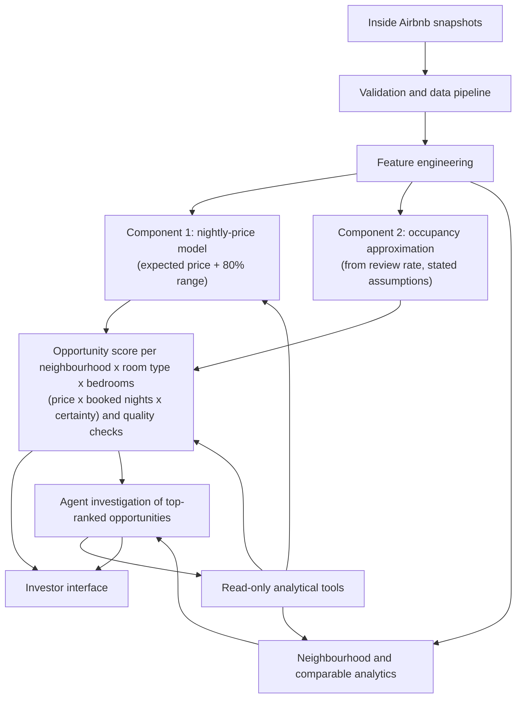

# Property Investment Intelligence System

BIU DS23 final project by **Erin Schaverien, Ron Ness, Idan Gilad and Adir Libovitch**.

> **Updated 31 Oct 2026.** This version answers the professor's remarks: what the system ranks (**Opportunity definition and score**), that the goals are fixed and approved before the results (**Data evidence** and **Success criteria**, matching `CHARTER.md`), that the model and the baseline are compared on the same split, with no listing on both sides, and how the model was improved and could be improved further (**Evaluation**). The price model's test run is labelled **exploratory**: the criteria were fixed before it, but the formal pre-registration commit was missed (see Evaluation).

## Purpose and status

Help short-term-rental investors decide **which type of property to investigate, and where**. The system ranks **opportunities**: combinations of a neighbourhood, a room type and a number of bedrooms. Each opportunity gets a score in currency per year, built from three defined components: the expected nightly price, the expected booked nights and the certainty of the price estimate. Agent investigations then gather the evidence for or against the top-ranked opportunities.

The product estimates **rental revenue potential**, not return on investment: the data has no purchase prices or operating costs (see Guardrails).

**Status: pipeline implemented, success criteria committed, price-model test results available (exploratory run).**
- Data preparation, EDA and feature engineering run on all cities in the Inside Airbnb extract.
- The nightly-price model, its evaluation and the agent's prediction tool are implemented per city (Amsterdam first).
- The opportunity score is implemented (`06_experiments`, `src/models/opportunities.py`), and its agent tool is `src/models/opportunity_tool.py` ([docs/opportunity_tool.md](docs/opportunity_tool.md)).
- The price model was scored on the held-out Amsterdam test set on 29 Oct 2026. It meets criteria 1, 2 and 4 and part of criterion 3 (see **Success criteria**). The ranking (criteria 5–6) and the agent (criteria 7–8) are not evaluated yet.

## Data evidence (Amsterdam)

| | |
| --- | --- |
| City | Amsterdam, Netherlands (prices in EUR) |
| Snapshot | Inside Airbnb release of **15 June 2026** (`scrape_id` 20260615212022; listing pages scraped 16–24 June 2026) |
| Rows | **10,369 listings** (one row per listing, one snapshot) |
| Price coverage | **61.5%** of listings (6,377) have a non-empty, positive price. The other 38.5% are excluded from modelling and ranking, so results describe **bookable, priced listings** |
| License | Inside Airbnb data, Creative Commons Attribution 4.0 International (CC BY 4.0): free to use with attribution to Inside Airbnb |

**Data-quality gate (the first check).** A city is modelled only if **at least 50%** of its listings have a price **and at least 3,000 priced listings** remain. Price is the target, so its coverage is checked before anything else. Amsterdam passes (61.5%, 6,377 priced listings). Every city added later gets the same five-line block and the same gate.

## Success criteria (committed before results)

These thresholds are fixed **before** the test set is scored and the ranking is evaluated. A criterion that is not met is reported as **not met**; thresholds are not changed after the results are known. Criteria 1–4 are also coded in `05_model_evaluation`'s pre-registration (`PREREG`), so they are applied mechanically.

**Approved by the team:** Erin Schaverien, Ron Ness, Idan Gilad and Adir Libovitch, on ____ (pull request #____). The same thresholds are stated in [CHARTER.md](CHARTER.md), whose **Checkpoint updates** section, at its end, tracks progress against them.

Results for criteria 1–4 come from one run on the Amsterdam test set (1,266 listings, 29 Oct 2026). That run is labelled **exploratory**, not confirmatory: the thresholds below were fixed in the design document and in the notebook's code before the run, and nothing was changed after it, but the pre-registration commit hash was not recorded (see Evaluation).

| # | Criterion | Committed threshold | Measured in | Result |
| --- | --- | --- | --- | --- |
| 1 | Price accuracy | test MAE **at least 10% below** the baseline (B1), **and** the 95% CI of the difference excludes 0 | `05_model_evaluation` (H1) | ✅ **met**: 75.0 vs 112.0 EUR/night on the **same 1,266 test listings**, **−33.0%**; difference CI [−42.1, −32.1] EUR |
| 2 | Interval calibration | the 80% price range covers **77–83%** of test prices | `05_model_evaluation` (H3) | ✅ **met**: **80.8%** [78.7%, 82.9%] |
| 3 | Segment safety | no room type or neighbourhood with **at least 100** test listings is worse than B1; no segment's coverage is **below 70%** | `05_model_evaluation` | ⚠️ **partly met**: no large room type or neighbourhood is worse than B1 ✅; coverage is below 70% in **2 segments** ❌, the cheapest 10% of listings (62.5%) and the most expensive 10% (49.6%) |
| 4 | Speed | prediction tool **under 200 ms** per call | `05_model_evaluation` | ✅ **met**: **27.7 ms** (model + interval, median single call) |
| 5 | Ranking stability | the top 10 keeps **at least 70%** of its opportunities under bootstrap resampling of the listings | `06_experiments` §7.3 | pending |
| 6 | Ranking robustness | the top 10 keeps **at least 70%** of its opportunities under the alternative occupancy assumptions (review rate 30–70%, average stay 2–4 nights) | `06_experiments` §7.4 | pending |
| 7 | Agent groundedness | **at least 95%** of the numbers the agent cites match the tool evidence log, on **20 frozen investigation cases**, with correct insufficient-evidence behaviour in every missing-data case | agent harness (Adir) | pending |
| 8 | Time saved | **at least 25% median reduction** in time per evidence brief versus the manual reference, at no more than an agreed cost per brief | agent harness (Adir, Ron) | pending |

## Architecture



The agent selects investigations, compares contextual evidence and explains contradictions. Cleaning, financial arithmetic, filtering, feature preparation, prediction and scoring remain in deterministic code. Investors can inspect the ranked table when the agent is unavailable.

## Opportunity definition and score

**An opportunity is a combination of a neighbourhood, a room type and a number of bedrooms, and its score is calculated from three defined components: the expected nightly price, the expected booked nights per year and the certainty of the price estimate.**

### Unit

| Element | Definition |
| --- | --- |
| Neighbourhood | `neighbourhood_cleansed` (Inside Airbnb's official neighbourhoods) |
| Room type | `room_type`: entire home/apt, private room, shared room, hotel room |
| Bedrooms | bands: 0–1, 2, 3+ |
| Eligibility | at least **20 priced listings** in the city's snapshot; smaller combinations are listed as "insufficient evidence", not ranked |

Example: *De Pijp – Rivierenbuurt × entire home/apt × 2 bedrooms.* This is the kind of choice an investor makes before buying: what to buy and where. Existing listings are evidence about each opportunity, not the things being ranked, since they are not for sale.

### The three components

| # | Component | Question it answers | How it is computed |
| --- | --- | --- | --- |
| 1 | **Expected nightly price** (EUR/night) | How much will such a property earn per booked night? | The nightly-price model's prediction for the opportunity's listings: the median of their **out-of-fold** predictions (each listing is predicted by a model that did not see it), so a listing's own price never sets its own estimate |
| 2 | **Expected booked nights** (nights/year) | How often will it be booked? | **Stated approximation from the review rate**, the method Inside Airbnb uses for `estimated_occupancy_l365d`: booked nights = reviews in the last 12 months ÷ review rate × average stay, where review rate = **50%** of stays get a review, average stay = **3 nights** or the listing's minimum stay if longer, capped at **70%** of the year (255 nights). The opportunity's value is the **mean** over its listings (inactive listings count as 0) |
| 3 | **Price certainty** (0–1) | How reliable is component 1? | Lower end of the 80% price range ÷ expected price, from the conformal (CQR) intervals. 1 = a precise estimate; lower = more spread among comparable properties |

### Score

```
Opportunity score (EUR/year) = expected booked nights × expected nightly price × price certainty
                             ≈ expected booked nights × lower end of the 80% price range
```

The score is a **conservative annual rental revenue**: the revenue at the pessimistic end of the normal price range. Uncertain opportunities are discounted automatically, in the same unit as the revenue. The output table also shows the **expected annual revenue** (components 1 × 2, without the discount) and each component separately, so an investor can see why an opportunity ranks where it does.

Output: `reports/<city>/opportunities.csv`, one row per opportunity, with:
- the three components, the score and the rank;
- the number of listings;
- the share of listings with a review in the last 12 months;
- an evidence identifier.

The agent reads it through a read-only tool, `src/models/opportunity_tool.py`: top-N with filters, the score breakdown of one opportunity, and the listings behind it ([docs/opportunity_tool.md](docs/opportunity_tool.md)).

### Occupancy decision

Occupancy is **inside the score, as a stated approximation**. Reviews are only a proxy for bookings: not every guest reviews, and review rates differ by segment. The assumptions above are therefore stated, not estimated, and criterion 6 tests how much the ranking depends on them.

*Considered and not chosen:* keeping occupancy outside the ranking (ranking on price and certainty only). It avoids the proxy, but the score would then be per night, and could not answer how much a property earns per year.

## Decisions

| Decision | Chosen | Alternative considered |
| --- | --- | --- |
| Bedroom bands | 0–1 / 2 / 3+ | exact bedroom count (more, smaller groups) |
| Minimum size of an opportunity | 20 priced listings | a lower threshold (more opportunities, noisier) |
| Occupancy | inside the score, stated approximation | outside the ranking, as context |
| Third component | price certainty | competition (listings within 1 km of the same room type) |
| Inactive listings | 0 booked nights (conservative) | left out of the average |
| Plan B | a second Inside Airbnb city | Zillow Research (different source and target) |

## Team

| Responsibility | Owner |
| --- | --- |
| Data and features, data evidence block | Erin Schaverien |
| Models, quantitative evaluation and the opportunity score | Idan Gilad |
| Agent, tools, guardrails and the investigation-task harness | Adir Libovitch |
| Product, architecture and investor output | Ron Ness |

Everyone contributes code and presents.

## Repository map

| Path | Contents |
| --- | --- |
| `CHARTER.md` | Business problem, committed success criteria, data evidence, Plan B, risks, milestones and checkpoint updates |
| `data/raw/`, `data/processed/` | Local datasets, excluded from Git |
| `data/data_dictionary.md` | Planned schema; replace with inspected source schema |
| `data/sources.md` | Source provenance per city: URL, download date, snapshot, rows, price coverage, license, checksum |
| `notebooks/` | Ordered EDA, preprocessing, modelling, evaluation and experiments |
| `src/` | Reusable ingestion, features, models, analytics and application code |
| `agents/` | Decision loop, tools, prompts and guardrails |
| `evaluation/` | Frozen evaluation cases, groundedness and error analysis |
| `models/` | Local model artifacts and version metadata |
| `reports/` | Baseline comparisons, results, figures and the opportunity table |
| `presentation/` | Final presentation and demo backup |
| `docs/` | Architecture decisions and delivery plan |
| `tests/` | Tests for the prediction-tool contract, city handling, engineered features and the opportunity score (`python -m pytest tests`) |

## Notebooks and data flow

Run the notebooks in order. Each reads the previous step's output from `data/processed/` (not in Git).

| Notebook | Owner | Reads | Writes |
| --- | --- | --- | --- |
| `01_Data_Preparation` | Erin | raw CSVs in `data/listings/`, `data/reviews/` | `listings_master.parquet`, `reviews_clean.parquet` |
| `02_EDA` | Erin | the files above | charts and maps in `reports/` |
| `03_Feature_Engineering` | Erin | the files above | `listings_features.parquet` (listings + engineered columns) |
| `04_modeling` | Idan | `listings_features.parquet`, `evaluation/splits/split_v1_<city>.json` | models in `models/` (not in Git) |
| `05_model_evaluation` | Idan | the same data and split, the saved models | `reports/<city>/`, `evaluation/test_runs.jsonl` |
| `06_experiments` | Idan | `listings_features.parquet`, the selected model and interval model, the split | `reports/<city>/opportunities.csv`, `opportunity_listings.csv`, `opportunities.json`; the ranking checks |

`06_experiments` adds the test listings to the opportunity table only after a **confirmatory** run of `05_model_evaluation`. The Amsterdam run was exploratory, so the table currently leaves the test listings out and is labelled `PROVISIONAL`.

Raw files are named `<city>_listings.csv` and `<city>_reviews.csv`, with the same lowercase city name in both (e.g. `amsterdam_listings.csv`).

**One model per city, one currency per model.** `04_modeling`, `05_model_evaluation` and `06_experiments` take a `CITY` parameter. Each city needs its own frozen split, created once from the repository root:

```bash
python -m src.models.make_split --data data/processed/listings_features.parquet --city Amsterdam
```

Which columns may become model features is decided in `evaluation/feature_audit.csv`. Price-derived columns are excluded as target leakage. `05_model_evaluation` scores each city's test set **once**: later runs are labelled exploratory.

The agent gets predictions through a read-only tool, `src/models/predict.py`, described in [docs/prediction_tool.md](docs/prediction_tool.md).

The *Modelling & Evaluation Design* document numbers its notebook blueprints differently: its "03_modeling" is `04_modeling` here, and its "04_model_evaluation" is `05_model_evaluation`.

## Environment and working order

```bash
git clone https://github.com/roness3yn/property-investment-intelligence-system.git
cd property-investment-intelligence-system
python -m venv .venv
source .venv/bin/activate          # Windows PowerShell: .venv\Scripts\Activate.ps1
python -m pip install -r requirements.txt
```

`requirements.txt` pins the libraries the notebooks and `src/` use. In VS Code, select the project's `.venv` as the kernel of **every** notebook; packages installed elsewhere are not visible to it. Shared code lives in `src/` (`src/models/` for modelling, evaluation and the prediction tool). The dashboard and LLM provider are chosen later.

## Data and reproducibility

Source: [Inside Airbnb](https://insideairbnb.com/get-the-data/), city by city. The verified facts for each modelled city are in its **data evidence** block (above, for Amsterdam) and in `data/sources.md`, together with the source URL, download date and file checksum.

**Plan B: a second Inside Airbnb city.** If Amsterdam fails the data-quality gate, or a second city is needed, the next city comes from the same source. It has the same columns and runs through the same pipeline by changing `CITY`. It is chosen by the same gate (price coverage at least 50%, at least 3,000 priced listings). Zillow Research, the charter's original fallback, is no longer the plan: it has a different source, country and target (property values, not nightly prices), so it would need a new pipeline.

Do not commit large datasets, credentials, host personal details or trained binary artifacts. Use local ignored directories or controlled external storage; document reproducible download steps. Record transformations and missing-value handling in the dictionary. Keep duplicate listing identities across snapshots out of both sides of the evaluation split, and fit preprocessing only on training data.

## Evaluation

The product is evaluated at three levels, each tied to the **Success criteria** above. **MAE is a quality check on component 1, not the product's goal:** an accurate nightly price does not by itself tell an investor where to buy.

### 1. Component quality (criteria 1–4)

| Component | Measure | Status |
| --- | --- | --- |
| 1. Expected nightly price | MAE (EUR/night) vs the baseline on held-out listings (criterion 1) | test: **75.0 vs 112.0 EUR/night (−33.0%)**, criterion met |
| 1/3. 80% price range | coverage (criterion 2: 77–83%), width, interval score | test coverage **80.8%** (met); mean width 242 EUR, median 74% of the predicted price; interval score 369 EUR |
| 2. Booked nights | agreement with Inside Airbnb's `estimated_occupancy_l365d`; sensitivity of the ranking to the assumptions (criterion 6) | implemented in `06_experiments` |

All alternatives use the same held-out cases and split.

**Same split, no listing on both sides.** The model and the baseline are scored on exactly the same 1,266 test listings. The split is **grouped by listing id**: every listing belongs to exactly one partition (train 7,257, calibration 1,037, test 2,075 listings before the price filter). No listing is used both to train and to test:
- `make_split` assigns whole listings, not rows, to partitions;
- `04_modeling` and `05_model_evaluation` verify the split's fingerprint and that the partitions are disjoint when they load it;
- `04_modeling` also asserts that no test listing reaches training or calibration.

The split is frozen in `evaluation/splits/split_v1_amsterdam.json` (version `2a418f50c8dc`). Amsterdam has one snapshot, so each listing is also a single row. With later snapshots, all rows of a listing stay in the same partition.

| Approach | MAE in selected city's currency/night | RMSE | Response time | Cost/query |
| --- | --- | --- | --- | --- |
| Training-set median by neighbourhood and room type, room-type and global fallback (B1) | 112.0 [104.7, 119.4] | 174.1 [159.5, 188.5] | 1.9 ms | ≈ 0 |
| Learned nightly-price model (gradient boosting, `hist_gbm`) | **75.0** [70.4, 79.7] | **113.0** [104.6, 121.3] | 27.7 ms (with interval) | compute only (≈ 0) |
| Deterministic opportunity table without agent | N/A | N/A | Not measured | Not measured |
| Agent investigation of the same top-ranked opportunities | N/A | N/A | Not measured | Not measured |

Values in brackets are 95% cluster-bootstrap confidence intervals (2,000 resamples of the test listings).

#### Test results for the price model (Amsterdam, 29 Oct 2026)

**Run label: exploratory.** The hypotheses, thresholds and selection rule were fixed in the *Modelling & Evaluation Design* document and in `05_model_evaluation`'s code (`PREREG`) before the run, and nothing was changed after it. The pre-registration commit hash was not recorded, so by the project's own one-shot rule the run is labelled exploratory, and the log in `evaluation/test_runs.jsonl` says so. The test set is not scored again. A confirmatory test needs data the models have never seen, such as a later Amsterdam snapshot, with the pre-registration committed first.

- **Test set:** 1,266 listings (20% of the priced listings, never used for training or tuning). The frozen target policy removed 10 more (price cap 1,567 EUR, minimum stay over 30 nights). Without that filter, MAE is 87.5 vs 125.5 EUR/night, still **30% better** than B1.
- **Selected model: default gradient boosting (`hist_gbm`)**, by the pre-registered rule. The tuned model with the kNN price feature scored 74.9 EUR/night, statistically indistinguishable (difference CI [−1.16, +1.33] EUR), so the simpler model is kept. Ridge regression (79.2) is clearly worse.
- **Consistent with development:** 5-fold CV on the training partition gave 77.3 vs 112.8 EUR/night (31% lower, in all 5 folds), and a shuffled-price check showed no sign of leakage.
- **Other accuracy measures (selected model):** median absolute error 47.0 EUR/night; 57% of listings predicted within ±20%; R² on log price 0.71. The model under-predicts on average (bias −19 EUR/night), mostly for the most expensive listings: it estimates the median price.
- **Hypotheses:** H1 supported (above). **H2 not supported** (as computed for the tuned model): entire homes gain more than other room types (33.8% vs 29.3%), but dense neighbourhoods do not gain more than others (32.9% vs 33.7%). H3 supported (coverage above). H4 not testable with one snapshot. **H5 supported:** adding availability features would lower MAE by 3.8 EUR/night but change which listings look over- or under-priced (residual rank correlation 0.893, below 0.90), which supports excluding them.
- **What drives accuracy (ablations):** removing the location features costs the most (+10.7 EUR/night), the review features +2.8. Removing the competitor counts (−0.1) or the amenity flags (+0.8) makes no significant difference.
- **Limitation (criterion 3, not met):** the 80% ranges cover only 62.5% of the cheapest 10% of listings and 49.6% of the most expensive 10%. These groups are defined by the actual price, so unusually cheap or expensive listings fall outside ranges built from their features. Ranges, and flags based on them, are least reliable at the price extremes. Room types and neighbourhoods are covered as intended (entire homes 80.4%, private rooms 82.1%).

### 2. Ranking quality (criteria 5–6)

- **Stability (criterion 5):** resample the listings (bootstrap, 200 times). The top 10 must keep at least 70% of its opportunities on average. The rank correlation is reported too.
- **Robustness (criterion 6):** rerun the score with review rates of 30%, 50% and 70% and average stays of 2, 3 and 4 nights. The top 10 must keep at least 70% of its opportunities.
- **Forward check** (needs a later snapshot of the same city, not a criterion yet): did the top-ranked opportunities keep higher prices and review activity than the rest?

### 3. Investigation task (criteria 7–8)

**Task:** produce an evidence brief for each of the top 10 opportunities in a city: the score breakdown, comparable listings, review signals and contradictions, with every number cited.

The task is done three ways: by the agent, by the deterministic table alone, and manually by a team member as the reference. They are compared on time per brief, cost per query, groundedness (cited numbers that match the tool logs, criterion 7) and failed tool calls.

### Metrics for component 1

The model predicts a number (the nightly listing price), so it is evaluated with regression metrics, all on the same held-out listings:

- **MAE** in the city's currency per night is the primary metric. It is easy to interpret and robust to the few very expensive listings.
- **RMSE** shows whether there are large misses. **MedAE**, **typical relative error** (a percentage error based on log ratios) and **hit rate within ±20%** describe typical and relative accuracy. **R²** is computed on log price.
- MAPE is not used, because it explodes on cheap listings.
- Every metric is reported with a 95% cluster-bootstrap confidence interval, overall and per segment (room type, neighbourhood, price decile).

**Target transformation.** Prices are right-skewed, so models train on log(1 + price) and convert back with exp. This estimates the *median* listing price, which is what MAE rewards. RMSE, which rewards the mean, uses Duan's smearing correction from out-of-fold residuals. Interval bounds are quantiles and need no correction. Details: `notebooks/05_model_evaluation.ipynb`.

### Improving the price model

#### What notebooks 04 and 05 already do

The model was improved step by step, each step measured on the same grouped cross-validation folds of the training partition, and the outcome checked on the held-out test set.

| Step | What it does | Result (Amsterdam) |
| --- | --- | --- |
| **Model ladder** (`04_modeling` §5–6) | each rung adds one ingredient, so its value is measured: global median → neighbourhood × room-type median (B1) → linear model (ridge) → gradient boosting with default settings (G1) → tuned gradient boosting with a kNN price feature (G2) | test MAE 132.6 → 112.0 → 79.2 → **75.0** → 74.9 EUR/night |
| **Hyperparameter tuning** (`04_modeling` §6.2, `src/models/tuning.py`) | seeded random search, 30 trials over 6 settings (learning rate, tree size, leaf size, L2 regularisation, feature share, kNN *k*), each scored on the same 5 grouped CV folds, with early stopping | the best trial **equals the defaults** (CV MAE 77.30 vs 77.34) |
| **Local-market feature** (`04_modeling` §6.2, `src/models/knn_features.py`) | median price of the *k* nearest listings, computed out-of-fold so a listing's own price never enters its own value | **no gain** (CV MAE 77.26 without it vs 77.30 with it) |
| **Log target** (`04_modeling`) | trains on log(1 + price), suited to skewed prices and to MAE | built in |
| **Target policy** (`04_modeling` §4.1) | removes placeholder prices and long-term rentals from training, with thresholds learned on training data only | built in |
| **Feature audit** (`evaluation/feature_audit.csv`) | keeps target-leaking columns (price-derived, availability) out of the model | protects the model's use for judging prices |
| **Ablations** (`05_model_evaluation` §9) | removes or adds feature groups and measures the change in test MAE | location features **+10.7 EUR/night** when removed, reviews **+2.8**; competitor counts and amenity flags **≈ 0** |
| **Seed stability** (`05_model_evaluation` §9) | refits with 5 random seeds | stable (range under 1 EUR/night) |

The gain came from the **type of model** (gradient boosting vs the baseline: −33%). Tuning and the extra feature did not add more, so the pre-registered selection rule kept the simpler model (G1). Whether tuning pays off can differ by city: the pipeline tests it per city and keeps the simpler model unless the added complexity measurably helps.

#### Possible further improvements

**Rule for any further improvement:** the Amsterdam test set has already been scored once, so improvements are developed and compared in `04_modeling` on the cross-validation folds only, against G1, and kept only if they win clearly and consistently across folds. A confirmatory check needs fresh data, such as a later Amsterdam snapshot with the pre-registration committed first; a new score on the current test set is reported as exploratory.

| # | Idea | Why it might help | Expected gain | Effort |
| --- | --- | --- | --- | --- |
| 1 | **Recover missing prices** | 38.5% of listings have no `price`, but the data also has `price_quote_price_per_night`. If it measures the same quantity (to be confirmed with the data owner), it could add up to about 60% more training listings; more data usually helps most | potentially the largest | low |
| 2 | **Text features** | the listing name and description carry what other columns miss ("canal view", "penthouse", "renovated"). Currently `defer` in the feature audit | medium–large | medium |
| 3 | **Better location features** | location is the strongest signal (ablation: +10.7 EUR/night). Distance to the centre or to key areas can add to raw coordinates | small–medium | low |
| 4 | **Train directly for MAE** | the model minimises squared error on log price; gradient boosting can minimise absolute error, the reported metric, directly | small | very low |
| 5 | **More amenities** | only 6 amenity flags and a count today, adding ≈ 0. The 30–50 most common amenities as flags may carry more | small | low |
| 6 | **Other boosting libraries** | CatBoost or LightGBM often do slightly better, especially with categories such as neighbourhood and property type | small (1–3% typical) | medium (new dependency) |
| 7 | **Bigger tuning budget** | 60 trials as the design suggests, or Optuna | unlikely: 30 trials found nothing beyond the defaults | low |

**Deliberately not used: availability features.** They would lower test MAE by 3.8 EUR/night (H5), but they are partly caused by the price (an overpriced listing stays empty), so they would make the below/above-market flags less trustworthy.

**Realistic expectation:** R² on log price is already 0.71, in the typical range for Airbnb price models. Part of the remaining error is not predictable from the data (photos, a host's own pricing choices, finishes), so further gains are likely to be a few euros per night, not another −33%.

The success criteria above are binding. `CHARTER.md` and `evaluation/README.md` must state the same thresholds.

## Guardrails

- The score is **conservative annual rental revenue potential** for a type of property in a place. It is not return on investment, profit or property value: the data has no purchase prices or operating costs.
- Compute ROI only with explicit acquisition and operating-cost inputs supplied by the user.
- Booked nights are an **approximation from reviews** with stated assumptions, not observed bookings. Availability is not confirmed occupancy.
- Nightly asking price is not realized revenue: guests may pay less after discounts.
- Results describe **priced listings** only (61.5% of Amsterdam's listings).
- Price ranges, and the below/above-market flags based on them, are least reliable for the cheapest and most expensive 10% of listings (test coverage 62.5% and 49.6%, against 80% overall).
- An opportunity with fewer than 20 priced listings, or whose price estimate the tool refuses, is reported as insufficient evidence and not ranked.
- Ground claims in tool outputs with source dates and evidence identifiers.
- Return insufficient evidence when data is missing or contradictory.
- The product supports investigation; it does not issue buy/no-buy instructions.

## Course deadlines

Charter: **4 October 2026**. Recommended pipeline checkpoint: **18 October**.
Recommended agent checkpoint: **30 October**. Pre-mentoring repository freeze: **1 November**.
Mentoring: **4 November**. Final slides and repository freeze: **12 November**.
Presentations: **15 or 18 November**, subject to team allocation.

See [CHARTER.md](CHARTER.md) and [delivery plan](docs/delivery-plan.md).

## Contributions

Work in short feature branches, open a pull request and describe the behavior and verification. Use issues to track ownership and acceptance criteria. See [CONTRIBUTING.md](CONTRIBUTING.md).
