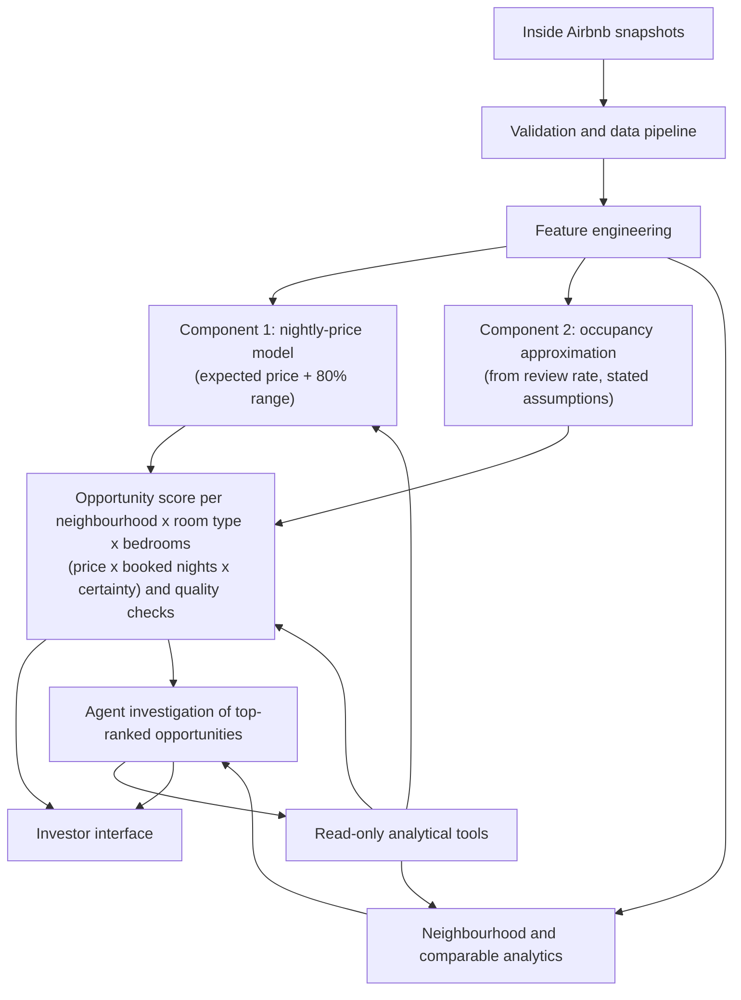

# Property Investment Intelligence System

BIU DS23 final project by **Erin Schaverien, Ron Ness, Idan Gilad and Adir Libovitch**.

> **Draft for team discussion (26 Oct 2026).** This version answers the Shlomits's remark that the ranked unit and the score were undefined. New or changed text is in **Purpose**, **Architecture**, **Opportunity definition and score**, **Evaluation** and **Guardrails**. Choices marked *(proposed)* need a team decision; the last section lists them. Remove this note once the decisions are made.

## Purpose and status

Help short-term-rental investors decide **which type of property to investigate, and where**. The system ranks **opportunities**: combinations of a neighbourhood, a room type and a number of bedrooms. Each opportunity gets a score in currency per year, built from three defined components: the expected nightly price, the expected booked nights and the certainty of the price estimate. Agent investigations then gather the evidence for or against the top-ranked opportunities.

The product estimates **rental revenue potential**, not return on investment: the data has no purchase prices or operating costs (see Guardrails).

**Status: pipeline implemented, final results pending.** Data preparation, EDA and feature engineering run on all cities in the Inside Airbnb extract. The nightly-price model, its evaluation and the agent's prediction tool are implemented per city (Amsterdam first). The opportunity score below is **specified but not yet implemented**. The held-out test set has not been scored yet.

The uploaded Project Charter defines Inside Airbnb as the primary source and Zillow Research as Plan B. The working document also describes an earlier Zillow-led market scope. This repository follows the charter's Airbnb scope.

## Architecture



The agent selects investigations, compares contextual evidence and explains contradictions. Cleaning, financial arithmetic, filtering, feature preparation, prediction and scoring remain in deterministic code. Investors can inspect the ranked table when the agent is unavailable.

## Opportunity definition and score

**An opportunity is a combination of a neighbourhood, a room type and a number of bedrooms, and its score is calculated from three defined components: the expected nightly price, the expected booked nights per year and the certainty of the price estimate.**

### Unit

| Element | Definition |
| --- | --- |
| Neighbourhood | `neighbourhood_cleansed` (Inside Airbnb's official neighbourhoods) |
| Room type | `room_type`: entire home/apt, private room, shared room, hotel room |
| Bedrooms | bands: 0–1, 2, 3+ *(proposed)* |
| Eligibility | at least **20 priced listings** in the city's snapshot *(proposed)*; smaller combinations are listed as "insufficient evidence", not ranked |

Example: *De Pijp – Rivierenbuurt × entire home/apt × 2 bedrooms.* This is the kind of choice an investor makes before buying: what to buy and where. Existing listings are evidence about each opportunity, not the things being ranked, since they are not for sale.

### The three components

| # | Component | Question it answers | How it is computed |
| --- | --- | --- | --- |
| 1 | **Expected nightly price** (EUR/night) | How much will such a property earn per booked night? | The nightly-price model's prediction for the opportunity's listings: the median of their **out-of-fold** predictions (each listing is predicted by a model that did not see it), so a listing's own price never sets its own estimate |
| 2 | **Expected booked nights** (nights/year) | How often will it be booked? | **Stated approximation from the review rate** *(proposed)*, the method Inside Airbnb uses for `estimated_occupancy_l365d`: booked nights = reviews in the last 12 months ÷ review rate × average stay, where review rate = **50%** of stays get a review, average stay = **3 nights** or the listing's minimum stay if longer, capped at **70%** of the year (255 nights). The opportunity's value is the median over its listings |
| 3 | **Price certainty** (0–1) | How reliable is component 1? | Lower end of the 80% price range ÷ expected price, from the conformal (CQR) intervals. 1 = a precise estimate; lower = more spread among comparable properties |

### Score

```
Opportunity score (EUR/year) = expected booked nights × expected nightly price × price certainty
                             = expected booked nights × lower end of the 80% price range
```

The score is a **conservative annual rental revenue**: the revenue at the pessimistic end of the normal price range. Uncertain opportunities are discounted automatically, in the same unit as the revenue. The output table also shows the **expected annual revenue** (components 1 × 2, without the discount) and each component separately, so an investor can see why an opportunity ranks where it does.

Output: `reports/<city>/opportunities.csv`, one row per opportunity, with:
- the three components, the score and the rank;
- the number of listings;
- the share of listings with a review in the last 12 months;
- an evidence identifier.

The agent reads it through a read-only tool (top-N, filters by neighbourhood or room type, score breakdown).

### Occupancy decision

Occupancy is **inside the score, as a stated approximation** *(proposed)*. Reviews are only a proxy for bookings: not every guest reviews, and review rates differ by segment. The assumptions above are therefore stated, not estimated, and the evaluation reports how the ranking changes when they change.

**Alternative** (if the team prefers): keep occupancy **outside the ranking**. Rank on components 1 and 3 only (the lower end of the price range), and show the occupancy approximation next to each opportunity as context. This avoids the proxy, but the score is then per night, not per year.

## Team

| Responsibility | Owner |
| --- | --- |
| Data and features | Erin Schaverien |
| Models and quantitative evaluation, opportunity score *(proposed)* | Idan Gilad |
| Agent, tools and guardrails | Adir Libovitch |
| Product, architecture and investor output | Ron Ness |

Everyone contributes code and presents.

## Repository map

| Path | Contents |
| --- | --- |
| `CHARTER.md` | Business problem, scope, proposed metrics, risks and milestones |
| `data/raw/`, `data/processed/` | Local datasets, excluded from Git |
| `data/data_dictionary.md` | Planned schema; replace with inspected source schema |
| `data/sources.md` | Source provenance and acquisition checklist |
| `notebooks/` | Ordered EDA, preprocessing, modelling, evaluation and experiments |
| `src/` | Reusable ingestion, features, models, analytics and application code |
| `agents/` | Decision loop, tools, prompts and guardrails |
| `evaluation/` | Frozen evaluation cases, groundedness and error analysis |
| `models/` | Local model artifacts and version metadata |
| `reports/` | Baseline comparisons, results, figures and the opportunity table |
| `presentation/` | Final presentation and demo backup |
| `docs/` | Architecture decisions and delivery plan |
| `tests/` | Tests for the prediction-tool contract, city handling and engineered features (`python -m pytest tests`) |

## Notebooks and data flow

Run the notebooks in order. Each reads the previous step's output from `data/processed/` (not in Git).

| Notebook | Owner | Reads | Writes |
| --- | --- | --- | --- |
| `01_Data_Preparation` | Erin | raw CSVs in `data/listings/`, `data/reviews/` | `listings_master.parquet`, `reviews_clean.parquet` |
| `02_EDA` | Erin | the files above | charts and maps in `reports/` |
| `03_Feature_Engineering` | Erin | the files above | `listings_features.parquet` (listings + engineered columns) |
| `04_modeling` | Idan | `listings_features.parquet`, `evaluation/splits/split_v1_<city>.json` | models in `models/` (not in Git) |
| `05_model_evaluation` | Idan | the same data and split, the saved models | `reports/<city>/`, `evaluation/test_runs.jsonl` |
| `06_experiments` | Idan | the same data and split, the saved models | |
| `07_opportunities` *(proposed)* | Idan | `listings_features.parquet`, the selected model and interval model | `reports/<city>/opportunities.csv` |

Raw files are named `<city>_listings.csv` and `<city>_reviews.csv`, with the same lowercase city name in both (e.g. `amsterdam_listings.csv`).

**One model per city, one currency per model.** `04_modeling` and `05_model_evaluation` take a `CITY` parameter. Each city needs its own frozen split, created once from the repository root:

```bash
python -m src.models.make_split --data data/processed/listings_features.parquet --city Amsterdam
```

Which columns may become model features is decided in `evaluation/feature_audit.csv`. Price-derived columns are excluded as target leakage. `05_model_evaluation` scores each city's test set **once**: later runs are labelled exploratory.

The agent gets predictions through a read-only tool, `src/models/predict.py`, described in [docs/prediction_tool.md](docs/prediction_tool.md).

The *Modelling & Evaluation Design* document numbers its notebook blueprints differently: its "03_modeling" is `04_modeling` here, and its "04_model_evaluation" is `05_model_evaluation`.

## Environment and working order

```bash
git clone https://github.com/roness3yn/property-investment-intelligence-system.git
cd property-investment-intelligence-system
python -m venv .venv
source .venv/bin/activate          # Windows PowerShell: .venv\Scripts\Activate.ps1
python -m pip install -r requirements.txt
```

`requirements.txt` pins the libraries the notebooks and `src/` use. In VS Code, select the project's `.venv` as the kernel of **every** notebook; packages installed elsewhere are not visible to it. Shared code lives in `src/` (`src/models/` for modelling, evaluation and the prediction tool). The dashboard and LLM provider are chosen later.

## Data and reproducibility

Primary source: [Inside Airbnb](https://insideairbnb.com/get-the-data/).
Fallback: [Zillow Research](https://www.zillow.com/research/data/).

The charter reports approximately 1.5 million listings across 153 CSV files and roughly 12 months of coverage. These are planning figures, not counts verified by this repository. Record city, source URL, download date, snapshot date, row counts, units, license and checksum in `data/sources.md`. Begin with one city and one currency.

Do not commit large datasets, credentials, host personal details or trained binary artifacts. Use local ignored directories or controlled external storage; document reproducible download steps. Record transformations and missing-value handling in the dictionary. Keep duplicate listing identities across snapshots out of both sides of the evaluation split, and fit preprocessing only on training data.

## Evaluation

The product is evaluated at three levels. **MAE is a quality check on component 1, not the product's goal:** an accurate nightly price does not by itself tell an investor where to buy.

### 1. Component quality

| Component | Measure | Status |
| --- | --- | --- |
| 1. Expected nightly price | MAE (EUR/night) vs the baseline on held-out listings; charter target at least 10% below the baseline | development result below; test pending |
| 1/3. 80% price range | coverage (target 77–83%), width, interval score | calibration coverage 80.3%; test pending |
| 2. Booked nights | agreement with Inside Airbnb's `estimated_occupancy_l365d`; sensitivity of the ranking to the review rate (30%, 50%, 70%) and the average stay (2, 3, 4 nights) | to implement |

All alternatives use the same held-out cases and split.

| Approach | MAE in selected city's currency/night | RMSE | Response time | Cost/query |
| --- | --- | --- | --- | --- |
| Training-set median by neighbourhood and room type, room-type and global fallback | Not measured | Not measured | Not measured | Not measured |
| Learned nightly-price model | Not measured | Not measured | Not measured | Not measured |
| Deterministic opportunity table without agent | N/A | N/A | Not measured | Not measured |
| Agent investigation of the same top-ranked opportunities | N/A | N/A | Not measured | Not measured |

*Development result (Amsterdam, June 2026 snapshot, 5-fold grouped CV on the training partition only):* the baseline's MAE is 112.8 EUR/night and gradient boosting's is 77.3 EUR/night (31% lower, in all 5 folds). A shuffled-price check shows no sign of leakage. Tuning and a kNN price feature gave no further gain. These are not test results.

### 2. Ranking quality

- **Stability:** resample the listings (bootstrap). How many of the top 10 opportunities stay in the top 10? Report the rank correlation.
- **Sensitivity:** rerun the score with the alternative occupancy assumptions above. A top-10 that changes completely is reported as assumption-driven.
- **Forward check** (needs a later snapshot of the same city): did the top-ranked opportunities keep higher prices and review activity than the rest?

### 3. Investigation task (time saved)

**Task:** produce an evidence brief for each of the top 10 opportunities in a city: the score breakdown, comparable listings, review signals and contradictions, with every number cited.

The task is done three ways: by the agent, by the deterministic table alone, and manually by a team member as the reference. Compared on time per brief, cost per query, groundedness (cited numbers that match the tool logs) and failed tool calls.

### Metrics for component 1

The model predicts a number (the nightly listing price), so it is evaluated with regression metrics, all on the same held-out listings:

- **MAE** in the city's currency per night is the primary metric. It is easy to interpret and robust to the few very expensive listings.
- **RMSE** shows whether there are large misses. **MedAE**, **typical relative error** (a percentage error based on log ratios) and **hit rate within ±20%** describe typical and relative accuracy. **R²** is computed on log price.
- MAPE is not used, because it explodes on cheap listings.
- Every metric is reported with a 95% cluster-bootstrap confidence interval, overall and per segment (room type, neighbourhood, price decile).

**Target transformation.** Prices are right-skewed, so models train on log(1 + price) and convert back with exp. This estimates the *median* listing price, which is what MAE rewards. RMSE, which rewards the mean, uses Duan's smearing correction from out-of-fold residuals. Interval bounds are quantiles and need no correction. Details: `notebooks/05_model_evaluation.ipynb`.

**Tuning.** Whether tuning pays off depends on the city. The pipeline tests it per city and keeps the simpler model unless the added complexity measurably helps.

Proposed targets and the evaluation design are in `CHARTER.md` and `evaluation/README.md`.

## Guardrails

- The score is **conservative annual rental revenue potential** for a type of property in a place. It is not return on investment, profit or property value: the data has no purchase prices or operating costs.
- Compute ROI only with explicit acquisition and operating-cost inputs supplied by the user.
- Booked nights are an **approximation from reviews** with stated assumptions, not observed bookings. Availability is not confirmed occupancy.
- Nightly asking price is not realized revenue: guests may pay less after discounts.
- An opportunity with fewer than 20 priced listings, or whose price estimate the tool refuses, is reported as insufficient evidence and not ranked.
- Ground claims in tool outputs with source dates and evidence identifiers.
- Return insufficient evidence when data is missing or contradictory.
- The product supports investigation; it does not issue buy/no-buy instructions.

## Open decisions for the team

1. **Bedroom bands:** 0–1 / 2 / 3+, or the exact number of bedrooms (more, smaller groups)?
2. **Minimum size:** 20 priced listings per opportunity, or another threshold?
3. **Occupancy:** inside the score as the stated approximation (proposed), or outside the ranking as context?
4. **Third component:** price certainty (proposed), or **competition** (listings within 1 km of the same room type, from `03_Feature_Engineering`)?
5. **Inactive listings:** count listings without reviews in the last 12 months as 0 booked nights (proposed: yes, conservative), or leave them out?
6. **Who builds what:** the scoring module and `07_opportunities` (Idan), the agent tool on top of it (Adir), the investor view of the table (Ron).

## Course deadlines

Charter: **4 October 2026**. Recommended pipeline checkpoint: **18 October**.
Recommended agent checkpoint: **30 October**. Pre-mentoring repository freeze: **1 November**.
Mentoring: **4 November**. Final slides and repository freeze: **12 November**.
Presentations: **15 or 18 November**, subject to team allocation.

See [CHARTER.md](CHARTER.md) and [delivery plan](docs/delivery-plan.md).

## Contributions

Work in short feature branches, open a pull request and describe the behavior and verification. Use issues to track ownership and acceptance criteria. See [CONTRIBUTING.md](CONTRIBUTING.md).
