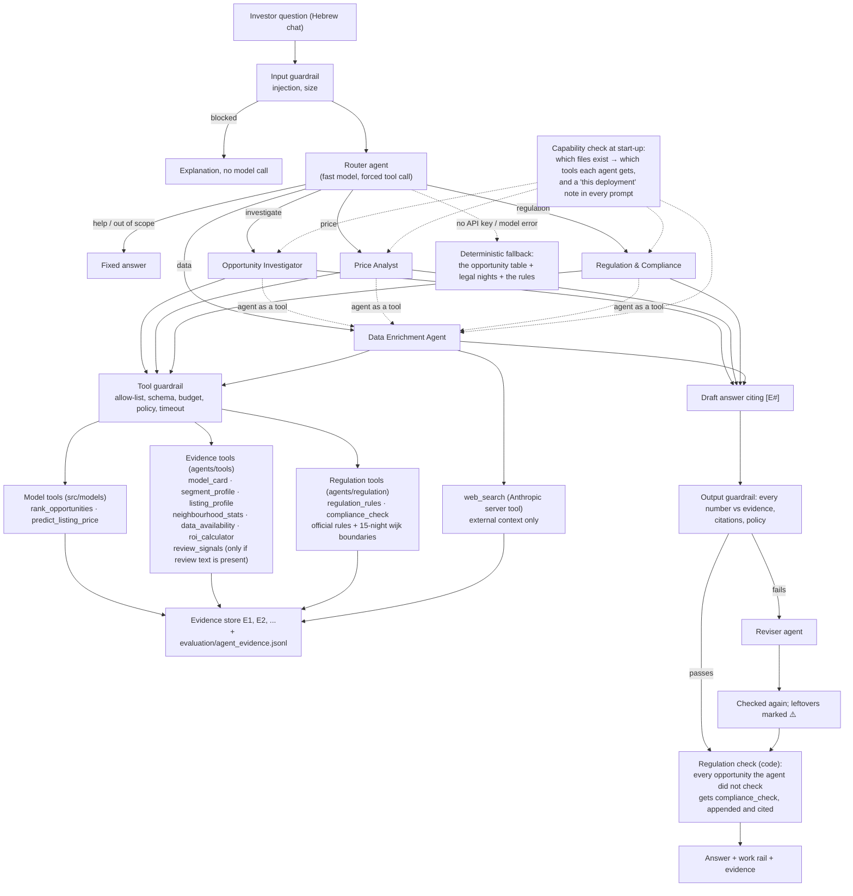

# Agents, tools and guardrails

**Owner:** agent, tools, guardrails and the investigation-task harness (Adir) · **Code:** `agents/`, chat in `src/app/streamlit_app.py` · **Tests:** `tests/test_agents.py`

The agents investigate the opportunities that the deterministic pipeline ranks. They do not
compute prices, scores or occupancy: those stay in the team's code (`src/models/`) and reach
the agents through read-only tools. The agents choose what to examine, gather evidence for and
against, explain contradictions, and every number they write is checked against the tool
results before the user sees it.

## Architecture



The loop is plain Anthropic SDK code (`agents/llm.py`, `run_agent`), so every decision is visible:
call the model with the agent's prompt and tools; run each requested tool through the tool
guardrail; return the results with their evidence references; repeat until the model answers or
the round limit is reached (then one last call with tools disabled).

## The agents

| Agent | Model | Job | Tools |
| --- | --- | --- | --- |
| Router | fast (`claude-haiku-5-5`) | classify the message: investigate, price, regulation, data, help, out of scope; extract the city | `route_request` (forced) |
| Opportunity Investigator | strong (`claude-sonnet-5-5`) | evidence briefs: why an opportunity ranks where it does, evidence for and against, cross-checks and contradictions, regulation, what to check next | `rank_opportunities`, `segment_profile`, `listing_profile`, `model_card`, `neighbourhood_stats`, `predict_listing_price`, `compliance_check`, `regulation_rules`, (`review_signals`), Enrichment agent |
| Price Analyst | strong | what-if prices for hypothetical properties and existing listings, with the model's reliability for that segment; revenue within the legal night cap; ROI only from the user's own numbers | `predict_listing_price`, `rank_opportunities`, `model_card`, `segment_profile`, `neighbourhood_stats`, `roi_calculator`, `compliance_check`, `regulation_rules`, Enrichment agent |
| Regulation & Compliance | strong | the local rules and what they mean for the ranking: who may rent, night caps by location, B&B permits, the score within the cap, what an investor may and may not do | `regulation_rules`, `compliance_check`, `rank_opportunities`, `segment_profile`, Enrichment agent |
| Data Enrichment Agent | strong | fills gaps: which data exists, model reliability, segment facts, rules of other cities and outside context from the web | `data_availability`, `neighbourhood_stats`, `segment_profile`, `model_card`, `regulation_rules`, (`review_signals`), `web_search` |
| Evidence Reviser | fast | fixes a draft the output guardrail rejected | none |

Prompts are versioned files in `agents/prompts/` (`version: 1.0`); every answer's trace records
which prompt versions produced it. All specialists share `_common.md`: the score definition and
the rules the output guardrail enforces.

## The tools

All tools are read-only, never raise (errors come back as data with a `status`) and return an
`evidence_id`.

| Tool | Source | Answers |
| --- | --- | --- |
| `rank_opportunities` | `src/models/opportunity_tool.py` (Idan) | top opportunities, one opportunity's score breakdown, the listings behind it |
| `predict_listing_price` | `src/models/predict.py` (Idan) | expected nightly price, 80% range and drivers for an existing or hypothetical listing |
| `model_card` | `agents/tools/evidence_tools.py` | how reliable the price model is: test MAE vs the baseline with CIs, range coverage, hypotheses, the run label, weak segments; per segment on request |
| `segment_profile` | `agents/tools/evidence_tools.py` | structured facts about an opportunity's listings: superhosts and professional hosts, registration status, activity, review scores, **Inside Airbnb's own occupancy estimate (an independent cross-check of booked nights)**, long-stay share, competition, amenities |
| `listing_profile` | `agents/tools/evidence_tools.py` | whitelisted facts about specific listings; the title is sanitised untrusted text; no host names or contact details |
| `neighbourhood_stats` | `agents/tools/data_tools.py` | observed asking prices and review activity per neighbourhood, for **any** city in the processed data (also cities without a model) |
| `review_signals` | `agents/tools/data_tools.py` | guest review themes and recent comments for listing ids; names removed, injections quarantined. **Enabled only when** `data/processed/reviews_clean.parquet` (or `reviews_amsterdam.parquet`) is present |
| `data_availability` | `agents/tools/data_tools.py` | cities, price coverage, the data-quality gate, which cities have a table and a model |
| `roi_calculator` | `agents/tools/roi.py` | gross/net yield and payback, **only** from a purchase price and costs the user supplied |
| `regulation_rules` | `agents/tools/regulation_tools.py` | the city's curated short-term-rental rules (R1..R10), each with its article, official or secondary source, effective date and verification date |
| `compliance_check` | `agents/tools/regulation_tools.py` | one opportunity, or the whole ranking: the regime (whole home = holiday rental, room = B&B), who may rent, each listing's night cap by its coordinates, legal nights, the score within the cap, red flags |
| `web_search` | Anthropic server tool | outside context (rules of other cities, changes after the rules' verification date, taxes); cited, labelled external, never used in the score |

**Capability-aware.** At start-up the orchestrator checks which files exist and gives each
agent only the tools that can answer. Every specialist's prompt ends with a generated "this
deployment" note: the cities, the table's label (e.g. PROVISIONAL), the model, and what is
missing and why. Today the repository ships the Amsterdam models, the opportunity table, the model
card and the 122-column feature file, but not the guest review text (too large for Git), so
`review_signals` is off and the agents use review scores and activity instead, and say that the
review text was not analysed. Adding the reviews file switches it on without code changes.

**Data enrichment.** When the opportunity table cannot answer (another city, a neighbourhood's
context, what guests say, regulation), the Investigator and the Price Analyst call the Data
Enrichment Agent as a tool. It works on the team's processed data first, and on the web only
for outside context. Every enriched fact enters the same evidence store, so it is cited and
checked like the model outputs.

## Regulation (Amsterdam)

The score estimates what a segment **earned** (from reviews of the twelve months before the
snapshot); the local rules decide what is **allowed**. `agents/regulation/` holds both as data
and code, and never changes the team's score:

| Rule | Content | Source |
| --- | --- | --- |
| R1 | holiday rental of a whole home only by a resident, in their main residence (registered there, 183+ nights a year); not for a second home or an investment property | Huisvestingsverordening Amsterdam 2024, art. 1, 3.7.4, 3.9.5 |
| R2 | at most 30 nights per calendar year | idem, art. 3.7.3 lid 1 |
| R3 | 15 nights from 1 April 2026 in eight wijken (Burgwallen-Nieuwe Zijde, De Weteringschans, Grachtengordel-West, Grachtengordel-Zuid, Haarlemmerbuurt, Jordaan, Nieuwmarkt/Lastage, Oude Pijp) | Eerste aanwijzingsbesluit 15-nachtencriterium |
| R4 | next step of the escalation ladder: a temporary stop | Beleidsregel escalatieladder vakantieverhuur |
| R5 | at most 4 guests | HVV 2024 art. 3.9.5, 3.9.6 |
| R6 | registration number in every advert; notice of every stay | HVV 2024 art. 3.7.2, 3.7.3 |
| R7 | a room is a B&B: permit within a quota per wijk, the host lives and sleeps there, max 40% of the floor area (61 m2), no night cap | HVV 2024 art. 3.7.5, 3.9.4, 3.9.6 |
| R8–R9 | fines and tourist tax (12.5%) | secondary source, labelled as such |
| R10 | the snapshot (15 June 2026) mostly predates the 15-night cap | data timing |

**Night cap per listing.** `amsterdam_15_night_wijken.geojson` holds the eight wijk boundaries
(City of Amsterdam GIS via Who's On First; Jordaan from the CBS buurt geometry). A listing gets
the 15-night cap when its coordinates fall inside one of them and its Inside Airbnb
neighbourhood contains such wijken (Centrum-West, Centrum-Oost, De Pijp - Rivierenbuurt), so a
simplified boundary cannot leak into another district. Centrum-West and Centrum-Oost are fully
covered by the city's wijk polygons.

**Score within the cap** = mean over the segment's listings of min(booked nights, the listing's
cap) × expected price × price certainty: the team's formula with the nights a resident host may
legally rent. For rank 2 (Centrum-Oost, whole home, 2 bedrooms) 67% of the listings are in
15-night wijken, legal nights fall from 73 to 13 and the score from EUR 22,436 to EUR 4,022. Rooms
(B&B) keep their score, but need a permit and a host who lives there. In both regimes
`investor_permitted` is false: a non-resident investor may not rent to tourists in Amsterdam.

**By construction, not by prompt.** The agents are told to call `compliance_check`, and the
orchestrator also checks after the answer: every opportunity a `rank_opportunities` result
presented that no `compliance_check` covered is checked in code and a cited "בדיקת רגולציה
אוטומטית" table is appended. The fallback (no API key) adds legal nights and the score within
the cap to its table, and answers regulation questions with the rules and their sources.

The rules carry `verified_on` (9 Nov 2026). They change: `web_search` is the route to anything
newer, labelled as external context. This is not legal advice.

## Guardrails

| Layer | Where | What it does |
| --- | --- | --- |
| Input | `agents/guardrails/input_guard.py` | blocks prompt-injection attempts (English and Hebrew patterns), empty and oversized messages, before any model call |
| Tools | `agents/guardrails/tool_guard.py` | per-agent allow-list; JSON-schema validation of arguments; call budget per agent and per turn; de-duplication; time limit; tool-specific policy (`roi_calculator` refuses a purchase price or cost the user did not give, and a revenue that is in no tool result) |
| Untrusted text | `agents/guardrails/injection.py`, `review_signals` | review comments are truncated, stripped of names, and quarantined if they contain instructions; the prompts say tool text is data |
| Output | `agents/guardrails/output_guard.py` | every number in the answer must match a tool result of this turn (rounding allowed) and should be cited; cited references must exist; no buy instructions, guarantees, or ROI without the calculator. A failing draft goes to the Reviser once; numbers still unverified are marked ⚠️ |
| Regulation | `agents/orchestrator.py` (`attach_regulation`), `agents/regulation/` | every opportunity presented gets a compliance check against the city's rules, appended in code if the agent did not do it |
| Availability | `agents/orchestrator.py` | without an API key or on a model error, the investor gets the deterministic opportunity table, with legal nights, and an explicit "agent unavailable" status; the chat stays open |

## Running it

Python **3.12 or newer** is required (the pinned numpy 2.5, pandas 3 and scikit-learn 1.9 have no
wheels for older versions; the models were saved with scikit-learn 1.9.1).

```bash
python -m pip install -r requirements-app.txt
cp .env.example .env                  # put ANTHROPIC_API_KEY in it (or paste it in the app's sidebar)
streamlit run src/app/streamlit_app.py
```

Or double-click `run_app.bat` (Windows) / run `./run_app.sh` (macOS, Linux). They look for Python
3.12+ (on Windows through the `py` launcher too), rebuild a `.venv` made with an older Python, and
repeat the installation if an earlier one failed (the marker `.venv/installed.ok` is written only
after a successful install).

**Without an API key** the app still answers in the chat, from the deterministic table and the
regulation rules; the **איך זה עובד** tab shows every agent's model, tools and full system
prompt, and the guardrails with their settings.

**Data.** The app reads the files the repository ships: `models/`, `reports/amsterdam/` and
`data/processed/listings_features.parquet`. Nothing has to be downloaded. Optional: guest reviews
(`data/processed/reviews_clean.parquet`, or a trimmed `reviews_amsterdam.parquet`) switch on
`review_signals`. Without any artifacts, the sidebar offers to build a small
**synthetic** demo repository (`python -m agents.demo_data --out demo_repo`), clearly
labelled as synthetic in the app. Set `PIIS_DATA_ROOT` to point at another folder.

Command line, without the UI:

```bash
python -m agents.cli "מהן ההזדמנויות המובילות באמסטרדם?"
```

## Evaluation (criteria 7 and 8)

```bash
python -m agents.harness              # 22 frozen cases: evaluation/eval_sets/agent_cases_v1.jsonl
```

It writes `evaluation/agent_results/run_<time>.json` with, per case and overall: groundedness
(criterion 7: at least 95% of cited numbers match the evidence log), correct
insufficient-evidence behaviour in every missing-data case, routing accuracy, and time and tokens
per answer (inputs to criterion 8's cost per brief). The chat's **יומן ראיות** tab shows the
same groundedness live. Every tool result is also appended to `evaluation/agent_evidence.jsonl`.

The groundedness check is deterministic: a number counts as grounded when it matches a value in
the tool results of the same turn, allowing for rounding ("342" for 342.37, "58%" for 0.577).
It cannot tell whether a correct number is used in the right sentence; the citation rate and a
manual review of a sample of briefs cover that.

## Tests

`python -m pytest tests/test_agents.py -q`: no API key and no real data needed. A small
synthetic repository is built once, and a scripted fake model replays the model's side of each
conversation through the real loop, tools and guardrails (routing, delegation, web-search
pause/resume, revision, fallback, every guardrail).
